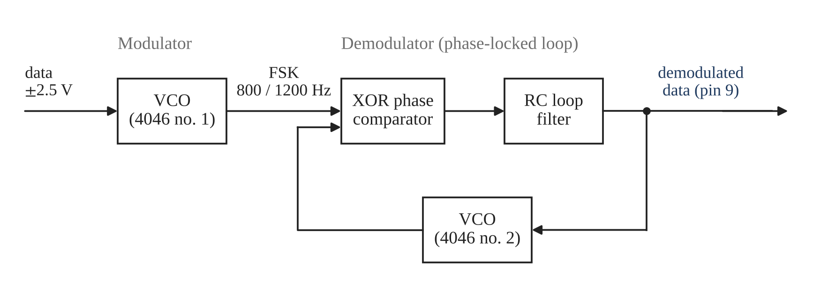
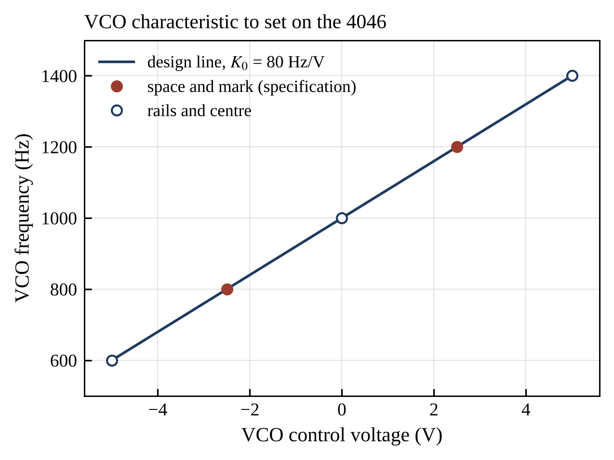
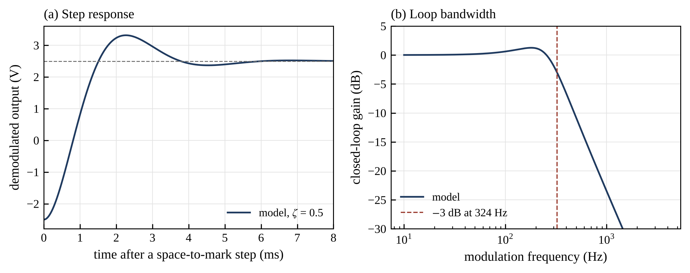
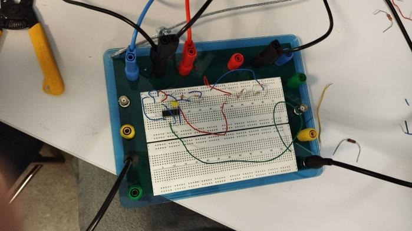
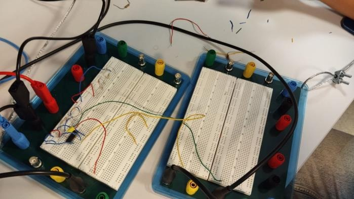
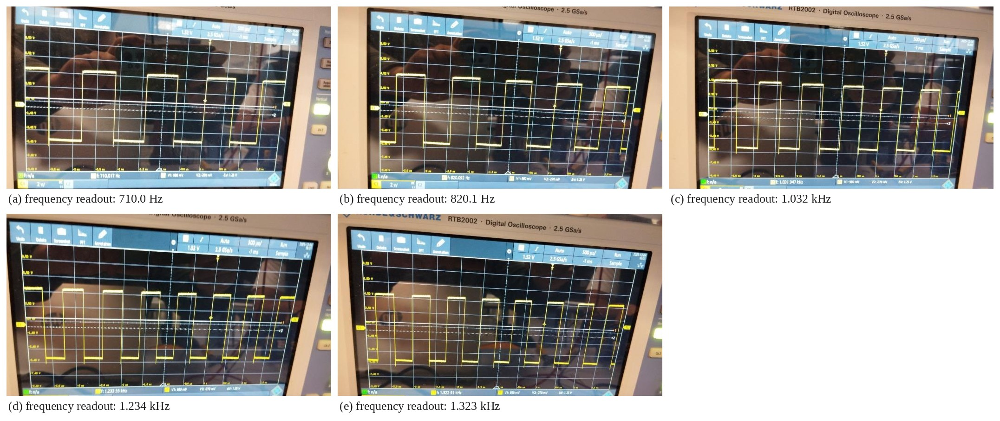

# FSK modulator and PLL demodulator on CD4046

Two CD4046 circuits on breadboards: the first one is a VCO used as an FSK modulator (800 / 1200 Hz), the second one is a phase-locked loop that demodulates it. Master Systèmes Communicants (M1), Sorbonne Université, course UM4EE101.

- **Tools:** CD4046, breadboards, ±5 V supply, function generator, Rohde & Schwarz RTB2002 oscilloscope, Python (NumPy, SciPy, Matplotlib)
- **Flow:** specification → loop design by hand → VCO tuning on the scope → loop closed → lock range, capture range, phase error and maximum bit rate measured
- **Result:** loop designed for ζ = 0.5 (τ = 625 µs, f<sub>n</sub> = 255 Hz); both VCOs tuned across the two FSK tones on the bench



## 1. Specification and loop design

The data levels are ±2.5 V on a ±5 V supply. The phase comparator is the XOR gate of the 4046 and the loop filter is a one-pole RC.

| Quantity | Relation | Value |
| --- | --- | --- |
| VCO gain K<sub>0</sub> | (1200 − 800) Hz / 5 V | **80 Hz/V** |
| VCO range at the rails | 1000 Hz ± 80 Hz/V × 5 V | 600 to 1400 Hz |
| Comparator gain K<sub>D</sub> | (V<sub>DD</sub> − V<sub>SS</sub>) / π | 3.18 V/rad |
| Loop gain K | 2π K<sub>0</sub> K<sub>D</sub> | 1600 s⁻¹ |
| Filter time constant τ | 1 / (4 ζ² K) | **625 µs** (6.25 kΩ with 100 nF) |
| Natural frequency f<sub>n</sub> | √(K / τ) / 2π | **255 Hz** |
| Lock range | f<sub>0</sub> ± K / 4 | 600 to 1400 Hz |



- The closed loop is H(s) = K / (τs² + s + K), so ζ = 1 / (2√(Kτ)). A longer τ filters the ripple better but lowers the damping.
- With an XOR comparator the phase error moves by ±π/2 around quadrature. The lock range then equals the full VCO range.
- The datasheet estimate of the capture range, (1/π)√(2π · 2f<sub>L</sub> / τ), gives 903 Hz. It exceeds the lock range, so every frequency the loop can hold is also captured.

## 2. Loop model

The script solves the second-order loop for a space-to-mark step and gives its bandwidth.



| Model output | Value |
| --- | --- |
| Overshoot | 16.3 % |
| Rise time, 10 to 90 % | 1.02 ms |
| Settling time to 5 % | 3.31 ms |
| −3 dB bandwidth | 324 Hz |
| Bit rate with D/2 = f<sub>−3 dB</sub> | **648 baud** (model) |

- An alternating 0101 pattern at D baud has its fundamental at D/2. The loop follows it while D/2 stays below the −3 dB bandwidth.

## 3. Bench build

R1, R2 and C1 of each VCO come from the 4046 datasheet curves and are then trimmed with the oscilloscope frequency readout. The demodulated data is the VCO control voltage of the second 4046 (pin 9).

**Modulator VCO on its breadboard, then both breadboards linked**




**VCO output on the RTB2002 while tuning and characterising it (2 V/div, 500 µs/div)**



| Capture | (a) | (b) | (c) | (d) | (e) |
| --- | --- | --- | --- | --- | --- |
| Frequency readout | 710.0 Hz | 820.1 Hz | 1.032 kHz | 1.234 kHz | 1.323 kHz |

- The output swings over the full supply and the readouts cover both FSK tones.

Measurements done on the closed loop:

| Measurement | Method |
| --- | --- |
| VCO characteristic F(V) | DC control voltage, frequency readout |
| Lock range | Start locked at the centre frequency, move the input until the loop drops out |
| Capture range | Start out of lock, move the input towards the centre until the loop locks |
| Phase error | Input and VCO output on two channels |
| Unlocked behaviour | Comparator output, VCO control voltage and VCO frequency |
| Maximum bit rate | Raise the data rate until pin 9 no longer follows the data, compare with theory |

## Run

```bash
pip install -r requirements.txt
python analysis/pll_design.py
```

The script prints the design table and writes figures 01 to 03.

## Credits

The specification and the lab statement come from the course. The design calculations, the bench work, the script and the figures are mine. The course statement and the lab report are not included.
